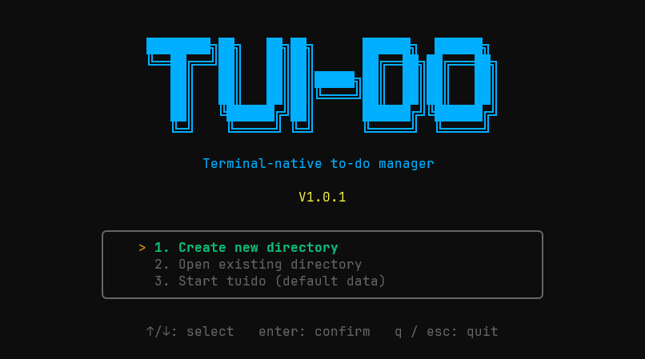
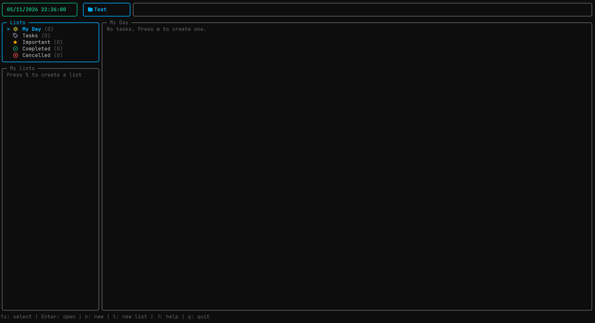
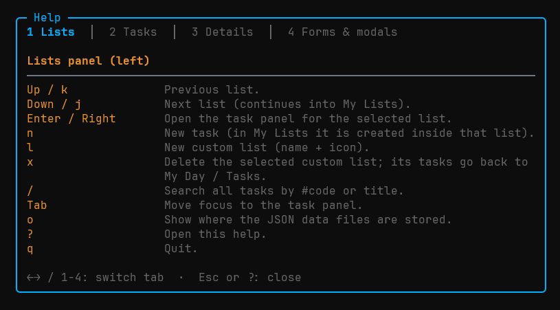
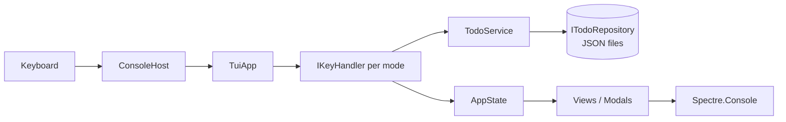

<p align="center">
  
</p>

<p align="center"><b>A terminal-native to-do manager with markdown notes, custom lists, priorities and a calendar.</b></p>

<p align="center">
  
  
  
  
  
  
  
</p>

<p align="center">
  <!-- IMAGE: start screen -->
  
</p>

---

## Table of contents

- [Overview](#overview)
- [Requirements](#requirements)
- [Getting started](#getting-started)
- [CLI commands](#cli-commands)
- [Usage and workflow](#usage-and-workflow)
- [Keyboard reference](#keyboard-reference)
- [Data storage](#data-storage)
- [Architecture](#architecture)
- [Testing](#testing)
- [Continuous integration](#continuous-integration)
- [Project layout](#project-layout)

## Overview

`tuido` is a text user interface (TUI) to-do application built with **.NET 10** and **Spectre.Console**.
The screen has two main panels: lists on the left and the tasks of the selected list on the right.
Every task has a code (`#1`, `#2`, ...), a date, a status, a priority and notes written in **markdown**.

Main features:

- Built-in lists: **My Day**, **Tasks**, **Important**, **Completed** and **Cancelled**.
- **Custom lists** with your own name and Nerd Font icon.
- Six statuses with their own icons and colors: *Not started*, *Doing*, *Need more details*, *Blocked*, *Completed* and *Cancelled* (plus an automatic *Overdue* marker).
- **Blocked by** relation between tasks, shown as `blocked by #N`.
- **Manual priority** inside My Day and custom lists.
- **Markdown preview** with scrolling, styled headings, code blocks, tables and checkboxes.
- Edit the *About* field in **Neovim, Vim or VS Code**.
- **Month calendar** with the number of tasks per day and their statuses.
- **Search** by task code or title.
- Top bar with a live clock and **notifications** for every change (success or error).
- Context-sensitive footer and a floating **help modal** (`?`).
- Start screen, interactive installer and uninstaller, and release check.

<p align="center">
  <!-- IMAGE: main screen with the lists and tasks panels -->
  
</p>

## Requirements

- Windows 10 or later (install, uninstall, clipboard and folder opening use Windows APIs).
- A terminal with UTF-8 support, such as Windows Terminal.
- **JetBrainsMono Nerd Font** configured in the terminal, otherwise the status icons will not render.
- [.NET 10 SDK](https://dotnet.microsoft.com/download) to build from source.
- Optional: `nvim`, `vim` or `code` in the `PATH` to edit notes externally.

## Getting started

### Run from source

```bash
dotnet run --project src/TuiDo
```

Pass arguments after `--`:

```bash
dotnet run --project src/TuiDo -- --help
```

### Publish and install

Run this in the repository root:

```bash
dotnet publish src/TuiDo -c Release -r win-x64 --self-contained -p:PublishSingleFile=true -o dist
```

Then install it:

```bash
dist\tuido.exe --install
```

Open a new terminal and run `tuido` from anywhere.

<p align="center">
  <!-- IMAGE: installer running -->
  
</p>

## CLI commands

| Command | Description |
|---|---|
| `tuido` | Open the start screen and then the app. |
| `tuido --version` (`-v`) | Show the version (starts at `v1.0.0`) and check whether the GitHub repository has a release with a different version. |
| `tuido --help` (`-h`) | Show a tabbed help panel: CLI commands plus the keys of every panel. |
| `tuido --install` | Interactive installer. Copies the program to `%LOCALAPPDATA%\Programs\tuido` and adds it to the user `PATH`. |
| `tuido --uninstall` | Interactive uninstaller. Removes the `PATH` entry, the program files and all data. It asks for confirmation first. |

Both the installer and the uninstaller show each step with a spinner and a status icon (completed or failed).

<p align="center">
  <!-- IMAGE: tuido --help with tabs -->
  
</p>

## Usage and workflow

1. **Start**. Run `tuido`, read the start screen and press `Enter`.
2. **Pick a list**. Use `Up`/`Down` in the left panel. My Lists (custom lists) appear below the built-in ones.
3. **Create a task**. Press `n`, fill in *Title*, *Date* (`dd/MM/yyyy`) and *About* (markdown), then press `Enter`.
4. **Work on it**. Press `Space` to choose a status. *Blocked* asks which open task is blocking this one.
5. **Organize**. Use `m` to move the task to a custom list, `p` to reorder it with the arrow keys, `P` to type its priority number and `i` to mark it as important.
6. **Read the notes**. Press `Enter` on a task to open the details panel and scroll the rendered markdown.
7. **Plan**. Press `c` for the month calendar.
8. **Find things**. Press `/` and type a code (`#3`) or part of a title.
9. **Finish**. Completed and cancelled tasks move to their own lists.

How tasks are placed in lists:

| Situation | List |
|---|---|
| Open task dated today or earlier | My Day |
| Open task dated in the future | Tasks |
| Starred open task | Important (also stays in its original list) |
| Status *Completed* | Completed |
| Status *Cancelled* | Cancelled |
| Moved to a custom list | That list (leaves My Day and Tasks) |

<p align="center">
  <!-- IMAGE: new task form -->
  
</p>

<p align="center">
  <!-- IMAGE: status modal -->
  
</p>

<p align="center">
  <!-- IMAGE: markdown details view -->
  
</p>

<p align="center">
  <!-- IMAGE: calendar modal -->
  
</p>

### Statuses

| Status | Meaning |
|---|---|
| Not started | First state of every task. |
| Doing | Work in progress. |
| Need more details | Waiting for information. Stays in My Day or Tasks. |
| Blocked | Waiting for another task. Stores the blocking task code. |
| Completed | Done. Moves to Completed. |
| Cancelled | Dropped. Moves to Cancelled. |
| Overdue | Not a stored status. Shown automatically for open tasks dated before today. |

## Keyboard reference

Press `?` inside the app for the full help modal. The most important keys:

**Lists panel**

| Key | Action |
|---|---|
| `Up` / `Down`, `k` / `j` | Select list |
| `Enter`, `Right` | Open the task panel |
| `n` | New task |
| `l` | New custom list (name + icon) |
| `x` | Delete the selected custom list |
| `/` | Search |
| `Tab` | Switch panel |
| `o` | Show data file location |
| `?` | Help |
| `q` | Quit |

**Task panel**

| Key | Action |
|---|---|
| `Enter` | Open details |
| `n`, `e` | New / edit task |
| `Space` | Change status |
| `m` | Move to a custom list |
| `p` / `P` | Reorder interactively / set priority number |
| `c` | Calendar |
| `i` | Toggle important |
| `d` | Delete |
| `Tab`, `Esc` | Back to the lists panel |

**Details panel**

| Key | Action |
|---|---|
| `Up` / `Down`, `j` / `k` | Scroll one line |
| `PgUp` / `PgDn` | Scroll one page |
| `Home` / `End` | Top / bottom |
| `e`, `Space`, `m` | Edit, change status, move |
| `Esc` | Back |

**Forms**

| Key | Action |
|---|---|
| `Tab` | Next field |
| `Enter` | Save |
| `Shift+Enter` | New line in *About* |
| `Ctrl+V` | Paste from the clipboard |
| `Ctrl+E` | Open *About* in Neovim, Vim or VS Code |
| `Esc` | Cancel |

## Data storage

Data lives in `%LOCALAPPDATA%\tui-do`:

- `tasks.json`: all tasks.
- `lists.json`: custom lists.

Press `o` in any panel to see the exact paths and open the folder. `tuido --uninstall` deletes this folder.

## Architecture

The project follows a layered design so that every piece of logic can be tested without a real terminal. Everything that touches the outside world (clock, disk, clipboard, editors, folders, keyboard) sits behind an interface and is injected.

```
src/TuiDo
├── Program.cs            Composition root and CLI dispatch
├── TuiApp.cs             The application without any I/O (state + key handlers + views)
├── ConsoleHost.cs        The only place with the real terminal loop
├── Domain                Entities, statuses, icon parser
├── Services              TodoService (business rules), NotificationLog
├── Abstractions          IClock, IKeySource, IClipboard, IEditorLauncher, IFolderOpener, ITerminal, ITodoRepository
├── Infrastructure        JSON repository, system clock, PowerShell clipboard, Explorer, external editors
├── Input                 One IKeyHandler per UI mode (browse, forms, pickers, overlays, search, ...)
├── Presentation          AppState, views, forms, modals, markdown renderer, scroll view, theme
└── Cli                   --version, --help, --install, --uninstall, start screen, logo
```



Design notes:

- **Domain** holds plain entities (`TodoItem`, `CustomList`, `Status`) and the `IconParser` that accepts hex codes, `\uXXXX` escapes, surrogate pairs and pasted glyphs.
- **Services** contain the rules: list membership, priority ranking, blocking relations, search and persistence. `TodoService` never touches the terminal.
- **Input** uses the *chain of responsibility* pattern. Handlers are registered in priority order in `TuiApp.Create`, and the first active handler consumes the key. A new UI mode needs one `IKeyHandler` and one renderer in `Presentation/Views`.
- **Presentation** is built from Spectre.Console renderables. `MarkdownRenderer` is a custom port of the visual rules of the clidocs viewer (headings, code boxes, tables, checkboxes) because Spectre has no markdown support.
- **Infrastructure** is the only layer that knows about files, PowerShell, Explorer and external editors.
- **Cli** runs before the TUI. `CliApp` handles the arguments, `HelpScreen` is the tabbed help (it reuses `HelpContent`, the same source as the in-app help), `Installer` handles install and uninstall, `GitHubReleaseChecker` queries the latest GitHub release, and `SplashScreen` shows the start screen.
- Culture is fixed to invariant, so dates stay `dd/MM/yyyy` and month names stay in English on every machine.

## Testing

The test suite uses **xUnit** and Spectre's `TestConsole`. Rendering tests drive the real `TuiApp` through `Support/TestApp` (fake clock, repository, clipboard, editor and folder opener), press keys, and assert on the rendered screen text.

```bash
dotnet test
```

A friendlier report, with one row per test (icon, name and duration), is available as a .NET 10 file-based script:

```bash
dotnet scripts/test-report.cs
dotnet scripts/test-report.cs --filter "FullyQualifiedName~Calendar"
```

<p align="center">
  <!-- IMAGE: test report table -->
  
</p>

What is covered: layout, lists and counters, priorities, status icons, forms and paste, every modal, markdown details and scrolling, search, calendar, help, notifications and their expiry, footer per panel, services, the JSON repository, the markdown renderer, and the CLI.

## Continuous integration

`.github/workflows/Functional-Tests.yml` runs on pull requests and on pushes to `main`:

1. **build**: restore, build and discover every test method.
2. **test**: a dynamic matrix with one job per test method, so each test has its own green check.
3. **all tests passed**: a single job that is green only when every test job passed (use it as the required check).
4. **test-report script**: smoke test for `scripts/test-report.cs`.

<p align="center">
  <!-- IMAGE: GitHub Actions run graph -->
  
</p>

## Project layout

```
tui-do
├── src/TuiDo                 Application
├── tests/TuiDo.Tests         xUnit tests (Rendering, Unit, Support)
├── scripts
│   ├── test-report.cs        Pretty test report (.NET 10 file-based app)
│   └── make-logo.ps1         Regenerates images/logo.png from the logo in Logo.cs
├── images                    README images
├── .github/workflows         CI
├── TuiDo.slnx                Solution
└── AGENTS.md                 Notes for coding agents
```

## Contributing

Close the running app before building, otherwise `tuido.exe` is locked. Keep Nerd Font glyphs as `\uXXXX` escapes in `Theme`/`Glyph` instead of repeating literals, and add a test for every new behavior.
