<p align="center">
  
</p>

<p align="center"><b>A terminal-native to-do manager with markdown descriptions, custom lists, priorities, a calendar and portable data directories.</b></p>

<p align="center">
  
  
  
  
  
  
  
</p>

<p align="center">
  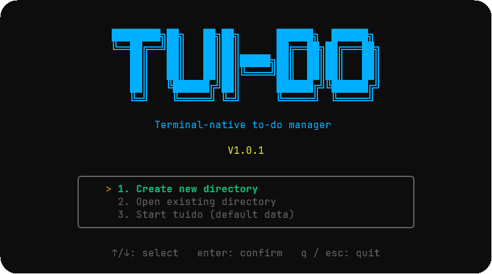
</p>

---

## Table of contents

1. [Overview](#overview)
2. [Requirements](#requirements)
3. [Getting started](#getting-started)
4. [CLI commands](#cli-commands)
5. [Features](#features)
   1. [Main menu](#1-main-menu)
   2. [Data directories](#2-data-directories)
   3. [Main screen](#3-main-screen)
   4. [Tasks](#4-tasks)
   5. [Statuses](#5-statuses)
   6. [Markdown descriptions](#6-markdown-descriptions)
   7. [Custom lists and icons](#7-custom-lists-and-icons)
   8. [Moving tasks between lists](#8-moving-tasks-between-lists)
   9. [Calendar](#9-calendar)
   10. [Switching directories](#10-switching-directories)
   11. [Search, notifications and help](#11-search-notifications-and-help)
6. [Keyboard reference](#keyboard-reference)
7. [Data storage](#data-storage)
8. [Architecture](#architecture)
9. [Testing](#testing)
10. [Continuous integration](#continuous-integration)
11. [Contributing](#contributing)

## Overview

`tuido` is a text user interface (TUI) to-do application built with **.NET 10** and **Spectre.Console**.
The screen has two main panels: lists on the left and the tasks of the selected list on the right.
Every task has a code (`#1`, `#2`, ...), a date, a time, a status, a priority and a description written in **markdown**.

## Requirements

- Windows 10 or later (install, uninstall, clipboard and folder opening use Windows APIs).
- A terminal with UTF-8 support, such as Windows Terminal.
- **JetBrainsMono Nerd Font** configured in the terminal, otherwise the icons will not render.
- [.NET 10 SDK](https://dotnet.microsoft.com/download) to build from source (not needed for the published `tuido.exe`).
- Optional: `nvim`, `vim` or `code` in the `PATH` to edit descriptions externally.

## Getting started

### Quick install (Windows 11, PowerShell)

One line that downloads the installer from the latest release into the temp folder and starts it:

```powershell
iwr https://github.com/F4NT0/tui-do/releases/latest/download/tuido.Installer.exe -OutFile "$env:TEMP\tuido.Installer.exe"; & "$env:TEMP\tuido.Installer.exe"
```

The installer then downloads `tuido.exe` from the same release, copies it to `%LOCALAPPDATA%\Programs\tuido` and adds it to your user `PATH`. Open a new terminal and run `tuido`. Each release must have `tuido.Installer.exe` and `tuido.exe` attached as assets.

### Run from source

```bash
dotnet run --project src/TuiDo
```

Pass arguments after `--`:

```bash
dotnet run --project src/TuiDo -- --help
```

### Publish and install

```bash
dotnet publish src/TuiDo -c Release -r win-x64 --self-contained -p:PublishSingleFile=true -o dist
dist\tuido.exe --install
```

Open a new terminal and run `tuido` from anywhere. The installer copies the program to `%LOCALAPPDATA%\Programs\tuido` and adds it to the user `PATH`.

## CLI commands

| Command | Description |
|---|---|
| `tuido` | Open the main menu and then the app. |
| `tuido --version` (`-v`) | Show the version and check whether the GitHub repository has a release with a different version. |
| `tuido --help` (`-h`) | Show a tabbed help panel: CLI commands plus the keys of every panel. |
| `tuido --today` | Print today's tasks in a table. |
| `tuido --install` | Interactive installer. |
| `tuido --uninstall` | Interactive uninstaller. Removes the `PATH` entry, the program files and the default data folder, after asking for confirmation. |

<p align="center">
  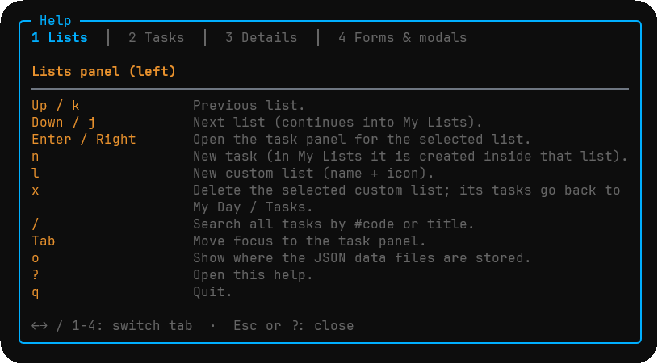
</p>

## Features

### 1. Main menu

The first screen is a centered menu inside a rounded box. Move with `Up`/`Down` or press `1`, `2` or `3`:

1. **Create new directory**: create a folder that holds your lists, tasks and markdown descriptions.
2. **Open existing directory**: browse to any folder and open it, even if it is empty.
3. **Start tuido (default data)**: use the default data folder in `%LOCALAPPDATA%\tui-do`.

`q` or `Esc` quits.

<p align="center">
  
</p>

### 2. Data directories

**Create new directory** asks for a name. The location starts at the folder where you ran `tuido`, and the final path is previewed as you type. Press `Tab` to choose another location in a floating folder browser:

| Key | Action |
|---|---|
| `Up` / `Down`, `PgUp` / `PgDn` | Move the cursor |
| `Right` | Go inside the highlighted folder |
| `Left`, `Backspace` | Go up one level (drives are listed above the root) |
| `Enter` | Select the **highlighted** folder |
| `Esc` | Cancel |

Long paths widen the panel; when they still do not fit, the user folder is abbreviated to `~` and, as a last resort, the middle is shortened with `…`.

The created directory looks like this:

```
my-tasks
├── tasks.json
├── lists.json
└── descriptions
    ├── 1-Write the report.md
    └── 7-Buy milk.md
```

Missing files are created on demand when you open any directory: `tasks.json` and `lists.json` on the first save, and `descriptions/` when the first description is written.

<p align="center">
  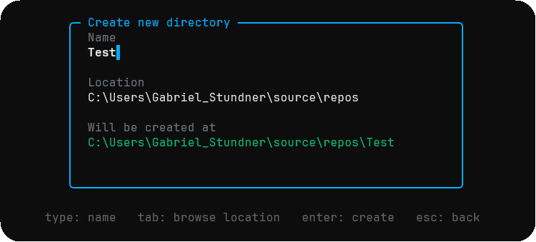
</p>

### 3. Main screen

- Top bar with a live clock, the name of the open directory and notifications.
- Built-in lists: **My Day**, **Tasks**, **Important**, **Completed** and **Cancelled**, each with a counter.
- **My Lists** below them for your custom lists.
- A context-sensitive footer shows only the keys that matter right now.

<p align="center">
  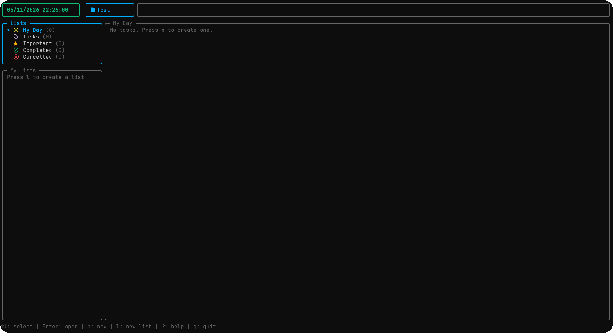
</p>

<p align="center">
  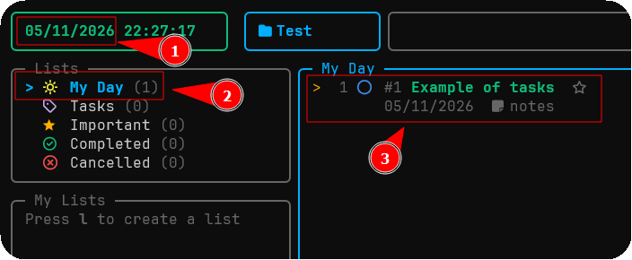
</p>

How tasks are placed in lists:

| Situation | List |
|---|---|
| Open task dated today or earlier | My Day |
| Open task dated in the future | Tasks |
| Starred open task | Important (also stays in its original list) |
| Status *Completed* | Completed |
| Status *Cancelled* | Cancelled |
| Moved to a custom list | That list (leaves My Day and Tasks) |

### 4. Tasks

Press `n` to create a task with *Title*, *Date* (`dd/MM/yyyy`), *Time* (`Ctrl+A` for *All Day*) and *About* (markdown). Press `e` to edit. Use `p` to reorder with the arrow keys, `P` to type a priority position, `i` to mark a task as important and `d` to delete it.

<p align="center">
  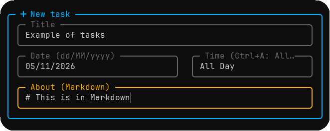
</p>

### 5. Statuses

Press `Space` on a task to choose a status. *Blocked* asks which open task is blocking this one and shows `blocked by #N`.

| Status | Meaning |
|---|---|
| Not started | First state of every task. |
| Doing | Work in progress. |
| Need more details | Waiting for information. Stays in My Day or Tasks. |
| Blocked | Waiting for another task. Stores the blocking task code. |
| Completed | Done. Moves to Completed. |
| Cancelled | Dropped. Moves to Cancelled. |
| Overdue | Not a stored status. Shown automatically for open tasks dated before today. |

<p align="center">
  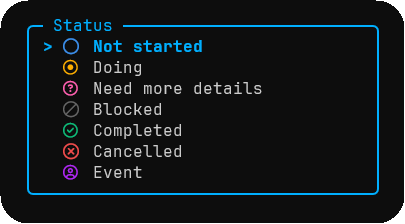
</p>

### 6. Markdown descriptions

Press `Enter` on a task to open its details and scroll the rendered markdown (headings, code blocks, tables and checkboxes). In forms, `Ctrl+E` opens the *About* field in **Neovim, Vim or VS Code**.

In a data directory, each description is stored as `descriptions/{code}-{title}.md`. The file is renamed when the task is renamed and deleted when the description is cleared. `tasks.json` does not repeat the text.

<p align="center">
  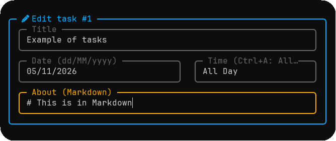
  <br /><br />
  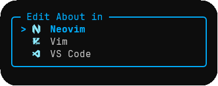
  <br /><br />
  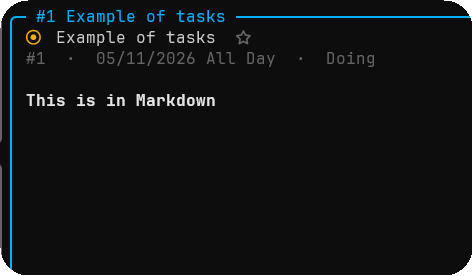
</p>

### 7. Custom lists and icons

Press `l` to create a list with a name and a Nerd Font icon. In the *Icon* field you can type a hex code (`f522`), a `\uXXXX` escape, paste the glyph, or press `i` to open a picker with ready-made icons. Move with the arrow keys, `Enter` chooses and `Esc` goes back to the form.

Press `x` on a custom list to delete it; its tasks return to My Day or Tasks.

<p align="center">
  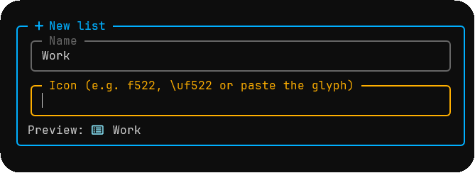
  <br /><br />
  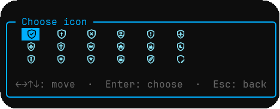
</p>

### 8. Moving tasks between lists

Press `m` to move a task to a custom list (or back to My Day / Tasks).

<p align="center">
  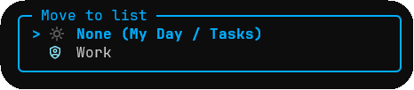
  <br /><br />
  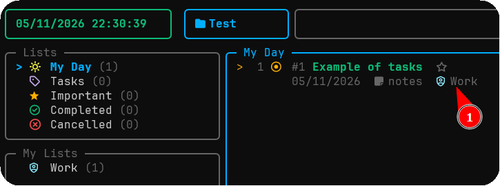
</p>

### 9. Calendar

Press `c` in the task panel for a month calendar with the number of tasks and their statuses per day. `Enter` on a day lists its tasks by time.

<p align="center">
  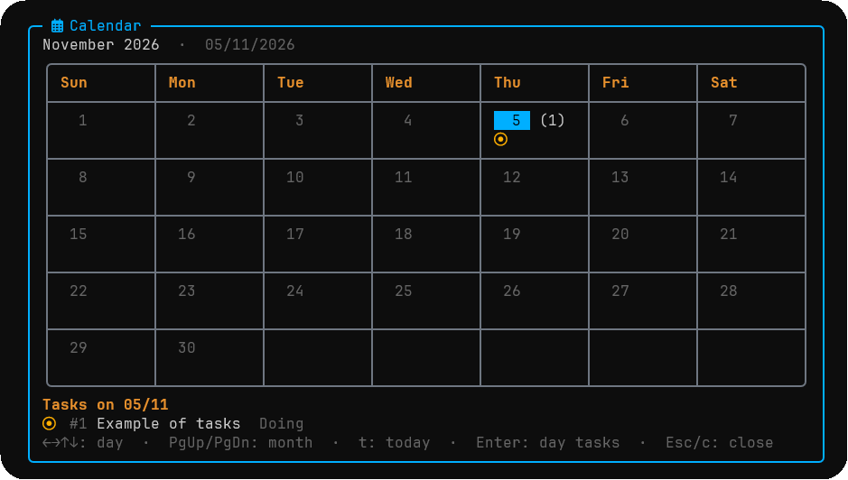
  <br /><br />
  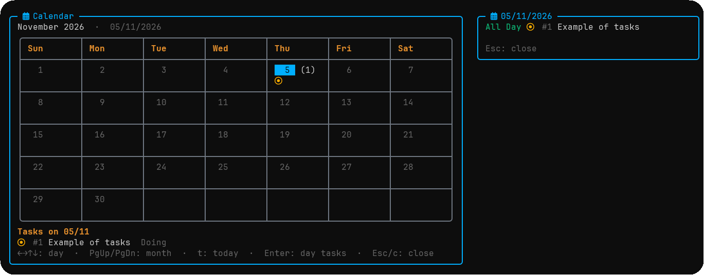
</p>

### 10. Switching directories

Press `d` in the lists panel to open the folder browser again and switch to another data directory without leaving the app. `Enter` opens the highlighted folder, its lists and tasks are loaded, and the top bar shows its name. In the task panel `d` still deletes the selected task.

Press `o` to see where the current data files are stored and open the folder in Explorer.

<p align="center">
  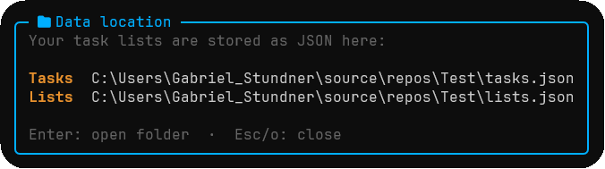
</p>

### 11. Search, notifications and help

- `/` searches every task by code (`#3`) or part of the title.
- Every change shows a success or error notification in the top bar.
- `?` opens a tabbed help modal; `tuido --help` shows the same content outside the app.

## Keyboard reference

Press `?` inside the app for the full help modal. The most important keys:

**Main menu and folder browser**

| Key | Action |
|---|---|
| `Up` / `Down`, `1`-`3` | Select an option |
| `Enter` | Confirm |
| `Tab` | Browse for the location (create directory) |
| `Right` / `Left` | Enter folder / go up (browser) |
| `q`, `Esc` | Quit / cancel |

**Lists panel**

| Key | Action |
|---|---|
| `Up` / `Down`, `k` / `j` | Select list |
| `Enter`, `Right` | Open the task panel |
| `n` | New task |
| `l` | New custom list (name + icon) |
| `x` | Delete the selected custom list |
| `d` | Switch data directory |
| `/` | Search |
| `Tab` | Switch panel |
| `o` | Show data file location |
| `?` | Help |
| `q` | Quit |

**Task panel**

| Key | Action |
|---|---|
| `Enter` | Open details |
| `n`, `e` | New / edit task |
| `Space` | Change status |
| `m` | Move to a custom list |
| `p` / `P` | Reorder interactively / set priority number |
| `c` | Calendar |
| `i` | Toggle important |
| `d` | Delete |
| `Tab`, `Esc` | Back to the lists panel |

**Details panel**

| Key | Action |
|---|---|
| `Up` / `Down`, `j` / `k` | Scroll one line |
| `PgUp` / `PgDn` | Scroll one page |
| `Home` / `End` | Top / bottom |
| `e`, `Space`, `m` | Edit, change status, move |
| `Esc` | Back |

**Forms**

| Key | Action |
|---|---|
| `Tab` | Next field |
| `Enter` | Save |
| `Shift+Enter` | New line in *About* |
| `Ctrl+V` | Paste from the clipboard |
| `Ctrl+E` | Open *About* in Neovim, Vim or VS Code |
| `Ctrl+A` | All Day (time field) |
| `i` | Icon list (icon field of a new list) |
| `Esc` | Cancel |

## Data storage

All JSON files are written **indented**. Where the data lives depends on how you started:

| Start option | Location | Descriptions |
|---|---|---|
| Create / open directory | The chosen directory: `tasks.json`, `lists.json`, `descriptions/` | One markdown file per task: `descriptions/{code}-{title}.md` |
| Default data | `%LOCALAPPDATA%\tui-do`: `tasks.json`, `lists.json` | Stored in `tasks.json` as the `Notes` field |

`tuido --uninstall` deletes only the default data folder; your own directories are never touched.

## Architecture

The project follows a layered design so that every piece of logic can be tested without a real terminal. Everything that touches the outside world (clock, disk, clipboard, editors, folders, keyboard) sits behind an interface and is injected.

```
src/TuiDo
├── Program.cs                 Composition root, CLI dispatch and start menu
├── TuiApp.cs                  The application without any I/O (state + key handlers + views)
├── ConsoleHost.cs             The only place with the real terminal loop
├── Domain                     TodoItem, CustomList, Status, IconParser
├── Services                   TodoService (business rules, directory switch), BuiltInLists, NotificationLog
├── Abstractions               IClock, IKeySource, IClipboard, IEditorLauncher, IFolderOpener, ITerminal, ITodoRepository
├── Infrastructure             JsonTodoRepository (indented JSON + markdown descriptions), system clock,
│                              PowerShell clipboard, Explorer, external editors
├── Input                      One IKeyHandler per UI mode (browse, forms, pickers, overlays, directory picker, search)
├── Presentation               AppState, DirectoryBrowser, BrowseModel, theme
│   ├── Views                  AppView, top bar, sidebar, task list, task detail, footer, modals, help content
│   ├── Forms                  TaskForm, ListForm (including the icon catalog)
│   └── Documents              MarkdownRenderer, ScrollView
└── Cli                        CliApp, StartMenu, SplashScreen, HelpScreen, Installer, release checker, logo

tests/TuiDo.Tests
├── Rendering                  Drive the real TuiApp through Support/TestApp and assert on the rendered screen
├── Unit                       Services, parsers, repositories, directory browser, CLI, markdown renderer
└── Support                    Fakes (clock, repository, clipboard, editor, folder opener) and TestApp
```

Design notes:

- **Domain** holds plain entities and the `IconParser`, which accepts hex codes, `\uXXXX` escapes, surrogate pairs and pasted glyphs.
- **Services** contain the rules: list membership, priority ranking, blocking relations, search and persistence. `TodoService` never touches the terminal and can swap its repository at runtime (`Switch`).
- **Input** uses the *chain of responsibility* pattern. Handlers are registered in priority order in `TuiApp.Create`, and the first active handler consumes the key. A new UI mode needs one `IKeyHandler` and one renderer in `Presentation/Views`.
- **Presentation** is built from Spectre.Console renderables. `MarkdownRenderer` is a custom renderer because Spectre has no markdown support.
- **Infrastructure** is the only layer that knows about files, PowerShell, Explorer and external editors. `JsonTodoRepository` stores notes inline by default, or as markdown files when `markdownDescriptions` is on.
- **Cli** runs before the TUI. `StartMenu` is the main menu and returns where the data lives; `CliApp` handles the arguments.
- Culture is fixed to invariant, so dates stay `dd/MM/yyyy` and month names stay in English on every machine.

## Testing

The test suite uses **xUnit** and Spectre's `TestConsole`: rendering tests press keys on the real `TuiApp` and assert on the screen text, and unit tests cover services, repositories, the directory browser, parsers, the CLI and the markdown renderer.

```bash
dotnet test
```

A friendlier report, with one row per test (icon, name and duration), is available as a .NET 10 file-based script:

```bash
dotnet scripts/test-report.cs
dotnet scripts/test-report.cs --filter "FullyQualifiedName~Calendar"
```

What is covered: layout, lists and counters, priorities, status icons, forms and paste, every modal, the icon picker, markdown details and scrolling, search, calendar, help, notifications and their expiry, footer per panel, directory switching, indented JSON, markdown description files (create, rename, delete, round trip, lazy folders), the folder browser, services, the markdown renderer and the CLI.

## Continuous integration

`.github/workflows/Functional-Tests.yml` runs on pull requests and on pushes to `main`:

1. **build**: restore, build and discover every test method, so new tests are picked up without editing the workflow.
2. **test**: a dynamic matrix with one job per test method (grouped by test class if there are more than 256), so each test has its own green check.
3. **all tests passed**: a single job that is green only when every test job passed (use it as the required check).
4. **test-report script**: smoke test for `scripts/test-report.cs`.

## Contributing

Close the running app before building, otherwise `tuido.exe` is locked. Keep Nerd Font glyphs as `\uXXXX` escapes in `Theme`/`Glyph` instead of repeating literals, and add a test for every new behavior.

GitHub ignores CSS, so the README images get their rounded corners from pre-processed copies in `images/rounded`. After adding or changing an image in `images/`, regenerate them with:

```bash
powershell -File scripts/round-images.ps1
```
